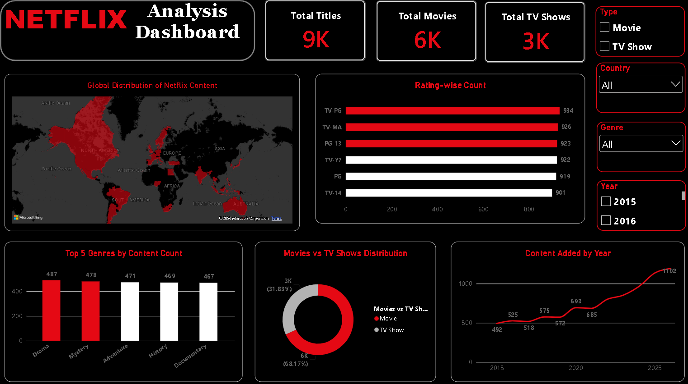

# Netflix Content Analytics — Power BI Dashboard

An interactive Power BI dashboard I built to analyse a Netflix-style content catalogue and viewing engagement data — what content exists, where it comes from, and how it has grown over time.

## What the dashboard shows

- **KPI cards** — Total Titles (9,000), Movies (6,135) and TV Shows (2,865)
- **Global Distribution of Netflix Content** — filled map of titles by country
- **Rating-wise Count** — titles by content rating (TV-PG is the largest group)
- **Top 5 Genres by Content Count** — Drama, Mystery, Adventure, History, Documentary
- **Movies vs TV Shows Distribution** — 68.2% movies / 31.8% TV shows
- **Content Added by Year** — titles added per year from 2015 to 2026
- **Slicers** for Type, Country, Genre and Year — every visual on the page cross-filters

## Dataset

Six related tables (educational sample data — cleaned and modelled for this project):

| Table | Rows | Contents |
|---|---|---|
| Content | 9,000 | Titles with type, genre, country, rating, IMDb score, date added |
| User_Engagement | 10,000 | Watch events: hours, completion %, device, subscription |
| Country | 25 | Producing-country dimension |
| Viewer_Country | 25 | Viewer-country dimension |
| Genre | 20 | Genre dimension |
| Calendar | 4,380 | Date table, 2015–2026 |

## Data model

Content connects to Country, Genre and Calendar (on Date Added). User_Engagement joins to Content on Content_ID, so viewing metrics can be analysed against any content attribute. Before building, I checked the data for duplicate keys and broken relationships — all six tables passed with no orphan records. The only blanks are structural (TV shows have no Duration_Minutes, movies have no Seasons).

## Measures (DAX)

Key measures used on the page: Total Content, Total Movies, Total TV Shows, Total Watch Hours, Average IMDb Rating and Average Completion Rate. The full measure library and calculated columns are in the `powerbi/` folder, along with the dark Netflix theme (black canvas, #E50914 red) used by the report.

## Key findings

- The catalogue grew from **492 titles added in 2015 to 1,192 in 2026 (+142%)**, with growth accelerating every year after 2019.
- **Movies dominate** at 68.2% of the catalogue, but TV shows hold a steady one-third share.
- **Drama is the largest genre** (487 titles); Mystery generates the most watch hours.
- Content ratings cluster tightly — the top six ratings sit between 901 and 934 titles, led by TV-PG.
- **Brazil is the top producing country** (395 titles), ahead of Spain and Nigeria.
- Viewers finish what they start: average completion is **70.6%**, with a 15.9% rewatch rate across 16,204 total watch hours.
- Licensed titles (avg IMDb 7.02) rate slightly higher than Originals (6.95), even though Originals make up 36% of the catalogue.

## Tools used

Power BI Desktop · DAX · Power Query · Excel/CSV data preparation

## Files in this repo

- `Netflix_Analytics.pbix` — the Power BI report
- `Netflix_Dashboard.png` — dashboard screenshot
- `data/` — the six CSV tables
- `powerbi/` — DAX measures, calculated columns and the report theme

*Note: the dataset is an educational sample with synthetic titles and engagement records. It is not Netflix's internal data, and the figures describe the sample only.*

---
**Ajit Karanjkar** — Data Analyst
[LinkedIn](https://www.linkedin.com/in/ajit-karanjkar-160763292)
